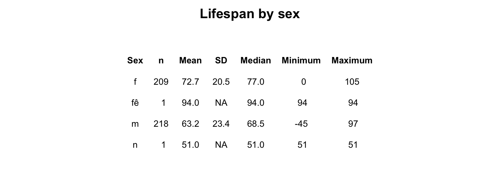
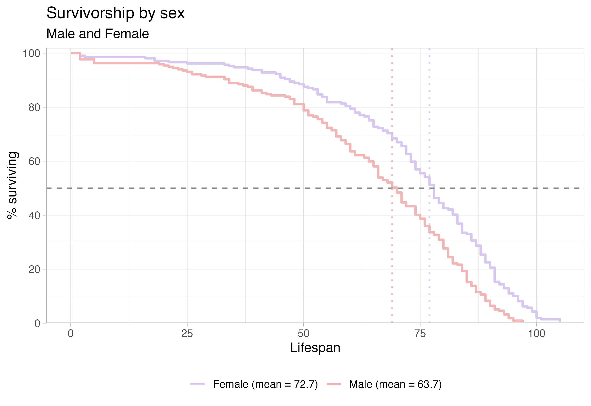

```{=latex}
\onecolumn
\begingroup
\thispagestyle{empty}
\sffamily

% Publication line and journal masthead
\noindent
\begin{minipage}[t]{0.66\linewidth}
  \scriptsize
  Ley and Vallad \textit{Survivorship Curves of Sunset Hill Cemetery}
  \hfill (2026) 1:1\\
  Valdosta State University, Ecology and Evolution
\end{minipage}
\hfill
\begin{minipage}[t]{0.30\linewidth}
  \raggedleft
  \large Cemetery Demography\\[-2pt]
  \large BIOL 3250
\end{minipage}

\vspace{0.28in}

% Article-type band
\noindent
\colorbox{reportred}{%
  \parbox{\dimexpr\linewidth-2\fboxsep\relax}{%
    \color{white}
    \textbf{RESEARCH ARTICLE}\hfill
    \textbf{CLASS PROJECT}
  }%
}

\vspace{0.18in}

% Title and author line
\noindent
{\fontsize{23}{27}\selectfont
\textbf{The difference between male and female lifespan in Sunset Hill Cemetery, Valdosta, Georgia}\par}

\vspace{0.12in}

\noindent
{\small
William Asa Ley\textsuperscript{1,*} and Alyssa Vallad\textsuperscript{1,*}
}

\vspace{0.08in}

% Structured abstract
\setlength{\fboxsep}{6pt}
\noindent
\fcolorbox{reportred}{white}{%
  \begin{minipage}{\dimexpr\linewidth-2\fboxsep-2\fboxrule\relax}
    \small

    \textbf{Abstract}

    \vspace{3pt}

    \textbf{Purpose:}
    This project describes lifespan patterns in cemetery records and examines
    variation by sex. 
    \vspace{3pt}

    \textbf{Methods:}
    Recorded available birth and death information from gravestones that peaked collective interest either by interesting names, features, or arrangement. Headstones classified as male or female based on classical name assumptions. Headstones that were difficult to make out due to weathering were ignored in this study.

    \vspace{3pt}

    \textbf{Results:}
    The class data showed that females outlive males by a noticable margin. Class data was also recorded based on military service versus non-military service members, and those values were not as seperate as expected. Class data collected on marital status. Males and females who are not married show less survivorship than those who are married at a younger age.

    \vspace{3pt}

    \textbf{Conclusions:}
    The patterns show that females generally have a longer life expectancy than males. Another observation is that there is little to no difference in life expectancy between men who served in the military and those who did not. However, this finding may be skewed because men who died in battle may not have been buried at home and therefore may not be included in the cemetery data. The data also shows that males and females who are not married have higher mortality rate at a younger age than those who are married.

    \vspace{3pt}

    \textbf{Keywords:}
    cemetery records; lifespan; survivorship; marital status; historical demography
  \end{minipage}%
}

% Bottom-page author and institutional details
\vfill

\noindent\rule{0.56\linewidth}{0.4pt}

\vspace{3pt}

\noindent
{\scriptsize
\textsuperscript{*}Correspondence: waley@valdosta.edu\\
\textsuperscript{1}Department of Biology, Valdosta State University,
Valdosta, Georgia, USA\\
Ecology and Evolution, BIOL 3250, Section B
}

\vspace{0.10in}

\noindent
\begin{minipage}[c]{0.20\linewidth}
  \includegraphics[width=0.72in]{Valdosta_State_University_seal.png}
\end{minipage}
\endgroup
\twocolumn
```

# Background

Cemetery records provide individual birth and death dates that can be used to describe lifespan among people represented in a burial ground. These records are a non-random sample: cemetery access, preservation of markers, migration, family burial practices, and the choice of graves to record may all affect which people appear in the dataset. The analyses below therefore describe the collected sample and should not be treated as direct estimates of lifespan for an entire town or historical population.

# Hypotheses

Write each hypothesis before interpreting the figures. State the expected direction and identify the comparison.

1. **Sex and lifespan:** I hypothesize that women will have a greater lifespan than men in this sample because of the war laden time period.

# Methods

Complete the prompts below. Replace bracketed text with details from the field visit and the final class dataset.

## Field site and sampling

- **Where did you go?** Sunset Hill Cemetery, Valdosta GA .
- **What date and time of day did you collect records?** 10/7/26, 2:00pm-4:00pm.
- **What part of the cemetery did you sample?**  30°50'27.6"N 83°17'17.8"W
- **How did you choose graves?** Graves were chosen based on quality of plot and interesting names.
- **How did you handle nearby graves and family plots?** Family plots were recorded together until we found a more interesting headstone.

## Recorded information and variable definitions

- **What information did you record from each marker?** From each headstone, we recorded First Name, Birth year, Death year, and sex.
- **How was lifespan calculated?** Lifespan was recorded based on subtracting year of birth from year of death.
- **How did you determine sex or gender?** Sex and gender was determined by context clues, such as marital status or parental significance. If not available, sex was determined by societal gender norms.
- **How were missing, illegible, or ambiguous records handled?** Illegible headstones were ommitted.

## Dataset and analysis

- **How many records were collected by you?** n = 58
- **How many records were included in the final analysis?** n =430; we excluted based on location and wethering on the headstone.
- **Were records aggregated with the class dataset?** Yes. each group of students were sent to different sections of the cematery.
- **What summaries or plots were produced?** Survivorship by birth period, survivorship by sex, survivorship by marital status for females, survivorship for marital status for males, survivorship by marital status, and survivorship by military status.
- **What are the limits of the sample?** The samples are only taken from Sunset Hill Ceme
tary.

# Results

The summary table in @fig-summary shows substantial differences in recorded lifespan by sex in this sample. Males had a mean lifespan of 63.2 years (SD = 23.4; n = 218), compared with 72.7 years (SD = 20.5; n = 209) for females. The marital-status breakdown is more tentative because each subgroup contains only one or two records. Among males, the married individuals had a mean lifespan of 66.6 years (SD = 20.6), while the unmarried individuals lived a mean of 60.8 years. Among females the recorded group had a mean of 74.7 years, compared with a mean of 71 years (SD = 23.4) for the unmarried individuals.

{#fig-summary width=90% fig-pos="t" fig-env="figure*"}

The sex-specific survivorship curves in @fig-sex show a different pattern: the plotted means are 61.1 years for males and 57.3 years for females. The male curve remains higher through much of the earlier and middle lifespan, while the female curve reaches the 50% survival point later. The curves are close and change relative position, so the figure suggests that the sex difference depends on which part of the lifespan distribution is considered. The median markers indicate where each group’s observed curve reaches 50% surviving; they are distinct from the mean values shown in the legend.

{#fig-sex width=70% fig-pos="t" fig-env="figure*"}


# Discussion

**Sex and lifespan.** Research on sex differences in longevity points to a combination of biological, behavioral, and social influences rather than a single explanation. Austad and Fischer review evidence on sex differences in lifespan and aging across species, including humans [@austadSexDifferencesLifespan2016]. In this cemetery sample, the observed female and male curves follow a similar curve, with males breaking off and experiencing higher death rates than women of the same age group and supports the prediction that women have higher lifespans then men. The result should be interpreted in the context of this cemetery’s birth cohorts and sampling process; it is not by itself an estimate of a general sex difference in lifespan.

**Limitations and next steps:** The sample of headstones recorded only came from Sunset Hill Cemetary, the results we found may be swayed by the local population rather than all who came from valdosta. For example, those in the military and who died in service may have been buried elsewhere. To continue this study, we plan on completing further records of a wider range of individuals.

```{=latex}
\newpage
```

### References

::: {#refs} 
::: 
